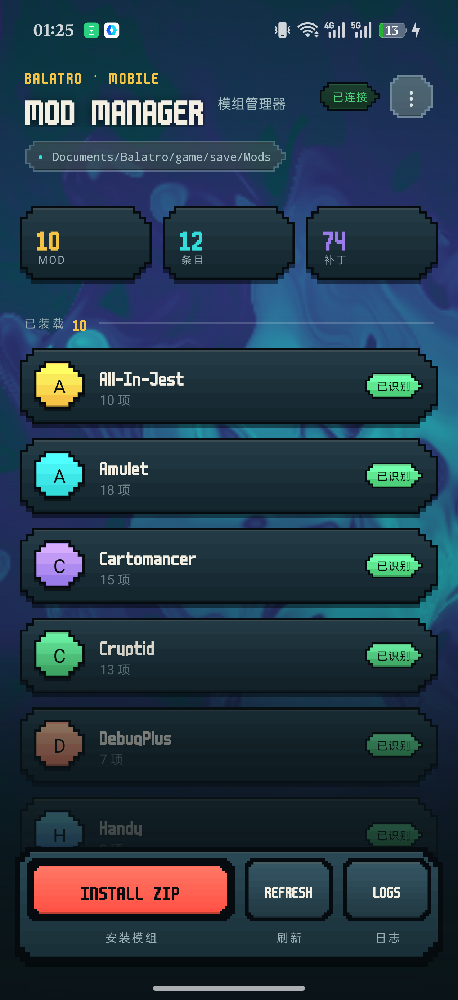
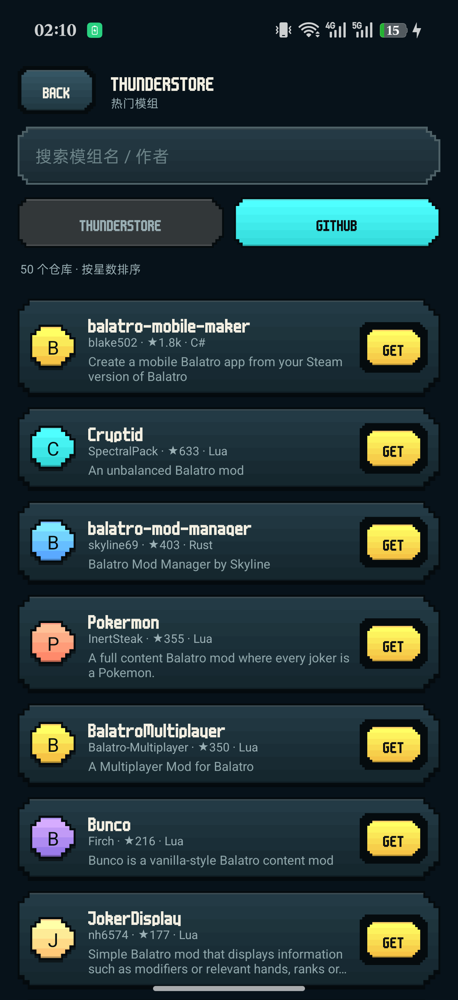
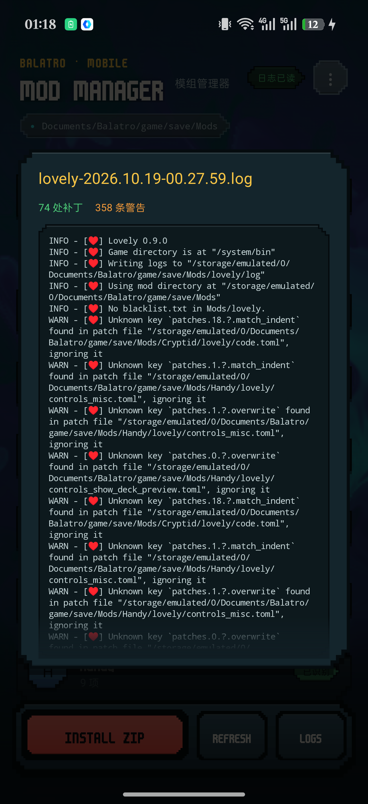

# Balatro Mods — Android 模组管理器

在手机上管理 Balatro 的 Steamodded 模组。装 ZIP、启用停用、删除、看 Lovely 日志，全部在浏览器式的图形界面里完成，不用连电脑。

界面沿用了游戏本体的视觉语言：真移植自 `background.fs` 的动态漩涡背景、原版的 `m6x11plus` 像素字体、贴纸式像素边框。



## 特性

- **在线目录**：两个来源可切换。
  - **Thunderstore**：Balatro 分区全部 170+ 个包，按下载量排序，可搜包名/作者/描述。列表缓存 6 小时，离线也能翻。
  - **GitHub**：按星数搜全站仓库，带主语言标签。下载默认分支的 zip，剥掉外层目录后装进 `Mods/{owner}-{repo}/`；里面没有 `.lua` 的会被拒绝并回滚，避免把源码仓库塞进游戏。
  - 已装过的包两个来源都会标成绿色 `OK`。
- **自动翻译**：详情页的英文描述会自动翻成中文（MyMemory 免费接口，无需 key），同一段描述只请求一次。
- **装模组**：从文件管理器选一个 ZIP，自动识别单层和嵌套（`xxx/xxx/`）两种打包结构，解到存档目录。同名模组会先删旧的再写，等于覆盖升级。
- **启停**：重命名时给目录加个后缀（如 `mymod_off`）即可临时停用，游戏不会加载它。
- **删除**：连同内部文件一起删，操作前二次确认。
- **日志**：内置查看器读 `lovely/log/` 下最新的一份 `.log`。超过 1 小时的日志会自动清理，但**永远保留最新一份**，免得打开时一片空白。
- **识别状态**：区分「已装载」/「需要处理」/「系统」，并标出哪些目录找不到 `main.lua` 入口、哪些是 Steamodded 本体或 Lovely。
- **全面屏**：适配刘海与手势条，底部操作栏是悬浮的，不占列表高度。

<p align="center">
  
  
</p>

## 安装

1. 下载 [`dist/BalatroMods.apk`](dist/BalatroMods.apk)，装到手机。
   （这是用仓库里的测试签名 `mm.keystore` 签的。如果你自己重新构建，签名不同，需要先卸载再装。）
2. 首次打开从右上角 `⋮` 里选一次存档目录：`Documents/Balatro/game/save/Mods`（走系统 SAF 授权，只对这一处有读写权）。
3. 授权一次后长期有效。

需要手机侧已经装好 Balatro（本仓库只做管理器，不含游戏本体）。

## 构建

没有 Gradle。整条链是 `aapt2 → javac → d8 → 塞 dex 进 apk → zipalign → apksigner` 手写的，构建产物 53 KB。

依赖：

| 变量 | 说明 | 默认 |
| --- | --- | --- |
| `ANDROID_BUILD_TOOLS` | build-tools 目录，需含 `aapt2`、`zipalign`、`lib/d8.jar`、`lib/apksigner.jar` | `D:/Java/signer/android-14` |
| `JAVA_HOME` | JDK 17+ | `D:/bmmwork/jdk-21.0.3+9` |
| `ANDROID_JAR` | `android.jar`（API 34） | `D:/bmmtmp/android-34/android.jar` |
| `PYTHON` | Python 3.8+ | `python` |

```bash
export ANDROID_BUILD_TOOLS="$HOME/Android/Sdk/build-tools/34.0.0"
export JAVA_HOME=/usr/lib/jvm/java-21-openjdk
export ANDROID_JAR="$HOME/Android/Sdk/platforms/android-34/android.jar"
./build.sh
```

产物在 `out/BalatroMods.apk`。首次构建会生成一个测试签名 `mm.keystore`，自己发布请换成自己的。

### 一个坑：d8 会 NPE

`javac` 21 会给匿名类的合成参数（`this$0`）写 `MethodParameters` 属性，其中 `name_index = 0`。`d8` 8.2 读到这儿会抛 `NullPointerException: Cannot invoke "String.length()"`。

`strip_mp.py` 就是干这个的：在 `javac` 之后、`d8` 之前把该属性从所有 `.class` 里剥掉。这个属性对运行没有任何作用，去掉不影响行为。

## 目录结构

```
AndroidManifest.xml
build.sh                  # 构建脚本
strip_mp.py               # 剥离 MethodParameters
assets/m6x11plus.ttf      # 游戏原版像素字体
java/com/balatro/modmanager/MainActivity.java
res/                      # 主题、图标、字符串
tools/                    # 开发期辅助：着色器移植预览、PNG 取色、图标切图、API 推送
docs/                     # README 配图
dist/                     # 已构建的 APK
```

`tools/make_icon.py` 把一张带灰底的方形 logo 图切成全套启动器图标：自动探测外接框 → 从四角泛洪抠掉圆角外的灰底 → 输出 legacy 图标和 adaptive icon 前景（108dp 画布、logo 占 76dp）。换图标只需重跑一次，`res/mipmap-*/` 会整体覆盖。

`MainActivity.java` 里值得一提的几处：

- `Swirl` —— `background.fs` 的 Java 移植，低分辨率位图（190px 宽）+ 20 FPS + 查表三角函数，实测占用可忽略。
- `PixelPanel` —— 阶梯方块的贴纸边框，全程关抗锯齿；小面积用色带填充，大面积退化成纯色（否则横向色带像百叶窗）。
- `display()` —— 像素字体按 11px 网格吸附字号，因为该字体行高只报 0.82em，不补内边距会裁掉上下缘。

`tools/gh_api_push.py` 是给网络受限环境准备的兜底：当 `github.com:443` 不通、只有 `api.github.com` 能连时，`git push` 会失败，这个脚本改用 Git Data API 复刻本地提交（上传 blob → 以父树为 base 建树 → 建 commit → 更新 ref），效果等价于推送。凭据从 `git credential fill` 现取，不写进任何文件。它只推一个提交，不替代日常 `git push`。

## 用到的外部接口

四个全部公开、**都不需要申请 API Key**，也都不需要登录，App 里没有任何写死的密钥或 token：

| 用途 | 地址 | 鉴权 | 限额 |
|---|---|---|---|
| 在线目录 | `thunderstore.io/c/balatro/api/v1/package/` | 无 | 未公开，实测 563 KB / 1.8 s |
| GitHub 搜索 | `api.github.com/search/repositories` | 无 | 未登录 10 次/分钟（按 IP，每翻一页算一次） |
| 仓库 zip 下载 | `codeload.github.com/{owner}/{repo}/zip/...` | 无 | 无特殊限制 |
| 英文描述翻译 | `api.mymemory.translated.net/get` | 无 | 匿名约 5000 字符/天/IP |

几个取舍：

- GitHub 搜索**未登录**是按 IP 限流的（实测 `search` 剩余 10/10、窗口 60 秒）。公共 Wi-Fi 下多人共用出口可能被 403，此时列表显示重试按钮，已缓存的目录不受影响。默认分支来自搜索结果里的 `default_branch` 字段，下载时不再额外调接口。
- MyMemory 是公益免费服务，额度耗尽时返回的不是错误页而是空结果。代码里把它当「翻不出来」处理，那一行直接不渲染，不会挡着看英文。
- Google 翻译的免费端点（`translate.googleapis.com`）在国内直连不通，实测 10 秒超时，所以没用它。
- 目录缓存 6 小时，缓存期内完全不联网。

## 已知限制

- 内置 Lovely 为 0.9.0。部分模组的补丁按 0.10 语法写，日志里会出现 `Unknown key` 之类的警告，通常不影响运行。
- 带 native 组件的模组（如 Talisman）在手机上跑不起来，需要桌面端。
- **主列表**（已安装的那些）仍是一次性渲染，装到 50 个以上首屏会有可感知的卡顿，而且没有本地筛选。在线目录那一边是按 60 条分页的。
- 翻译走 MyMemory 的免费额度（匿名单 IP 每天约 5000 字符），翻得多了会失败——失败时那一行会自动隐藏，不影响阅读英文原文。
- GitHub 那边能下载不代表能跑：仓库质量参差，很多是源码或工具，装进去也可能报错。装之前看一眼语言标签，`Lua` 的才大概率可用。

## 版权

- 本项目与 LocalThunk、Steamodded、Lovely 的官方无关。
- `assets/m6x11plus.ttf` 提取自 Balatro 本体，仅用于让界面与游戏视觉一致；版权归原作者所有。若权利人要求，会移除。
- Balatro 是 LocalThunk 的商标。

## 作者

Jasper Wang
